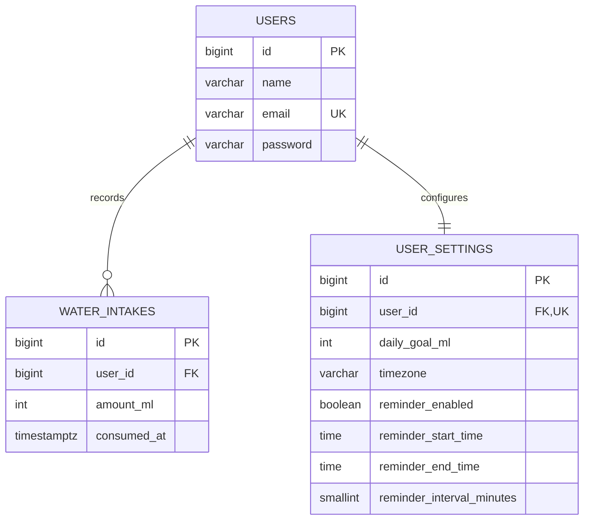

# Database Design

AquaTrack targets PostgreSQL. Application timestamps are written in UTC; a user's IANA timezone is used only to calculate local-day boundaries and format responses.

## Tables

### `users`

| Column | Type | Notes |
| --- | --- | --- |
| `id` | bigint | Primary key |
| `name` | varchar | Display name |
| `email` | varchar | Unique, normalized by the login flow |
| `password` | varchar | Laravel-hashed password |
| `email_verified_at` | timestamptz, nullable | Framework-ready |
| `remember_token` | varchar, nullable | Framework-managed |
| timestamps | timestamptz | Created/updated times |

### `water_intakes`

| Column | Type | Notes |
| --- | --- | --- |
| `id` | bigint | Primary key |
| `user_id` | bigint | FK to users; cascades on delete |
| `amount_ml` | unsigned integer | Validated from 1–10,000 mL |
| `consumed_at` | timezone-aware timestamp | Exact drink time, persisted in UTC |
| timestamps | timestamps | Created/updated times |

An index on `(user_id, consumed_at)` supports per-user date-range queries. Every drink remains a separate row; daily totals are never persisted.

### `user_settings`

| Column | Type | Notes |
| --- | --- | --- |
| `id` | bigint | Primary key |
| `user_id` | bigint | Unique FK to users; cascades on delete |
| `daily_goal_ml` | unsigned integer | Demo default: 1,500 mL |
| `timezone` | varchar | IANA name; default `Asia/Phnom_Penh` |
| `reminder_enabled` | boolean | Default false |
| `reminder_start_time` | time | Default 07:00 |
| `reminder_end_time` | time | Default 21:00 |
| `reminder_interval_minutes` | unsigned smallint | Default 60 |
| timestamps | timestamps | Created/updated times |

Laravel also creates framework `sessions`, `cache`, `jobs`, and password-reset tables.

## Relationships

## Date-boundary example

For `Asia/Phnom_Penh`, 2026-10-27 spans UTC instants `2026-10-26 17:00:00Z` through (but not including) `2026-10-27 17:00:00Z`. The API converts that local window to UTC before querying. This prevents drinks near midnight from appearing on the wrong local day.
